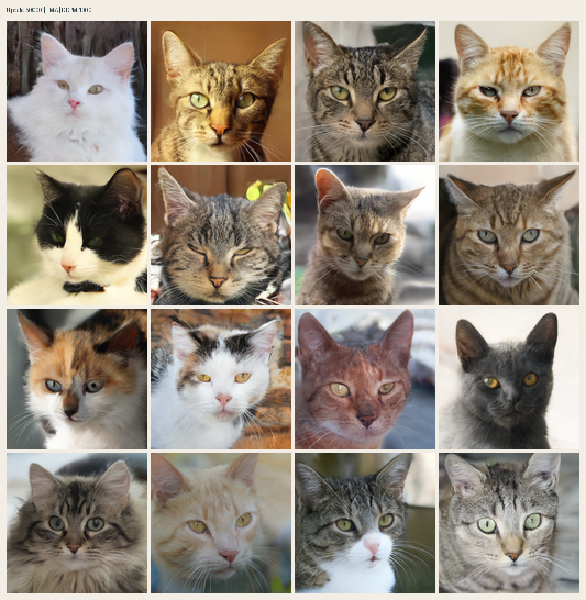
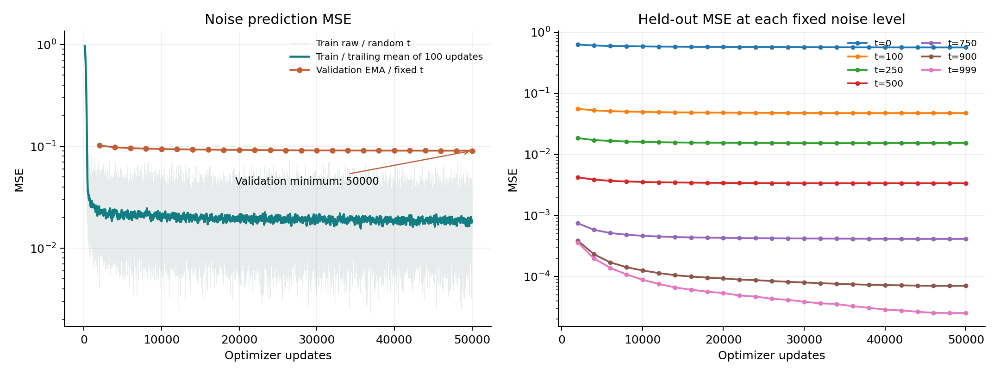
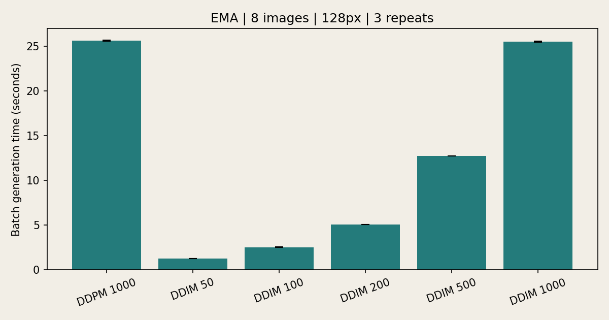
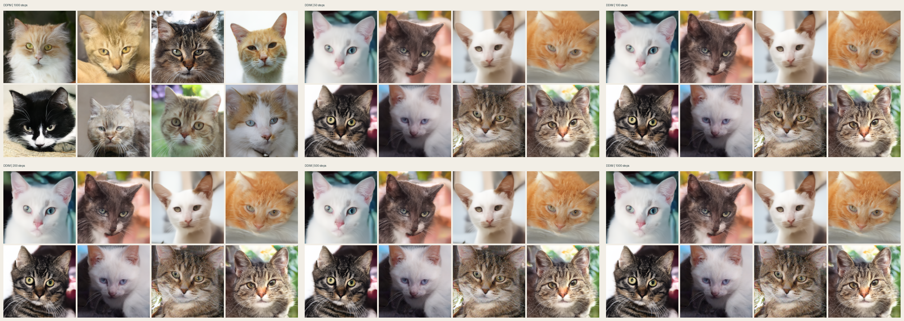
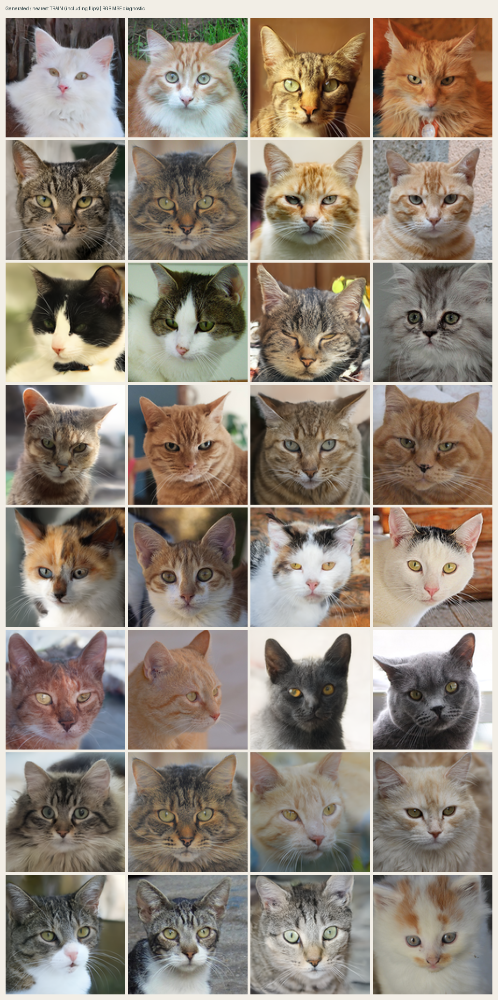
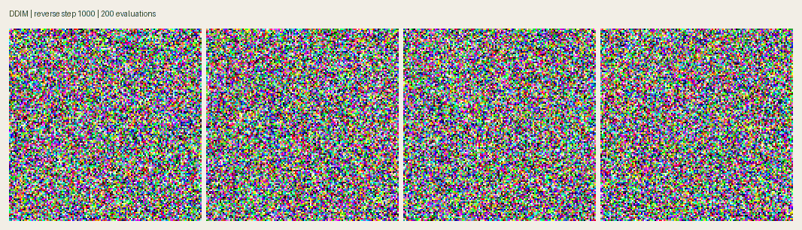

# Генерация котов с помощью DDPM и DDIM

Обучение диффузионной модели с нуля на **AFHQv2** и сравнение DDPM/DDIM на одном EMA checkpoint: **78 642 819 параметров, 128×128, 50 000 обновлений на четырёх A100 80 GB**. Реализация на PyTorch без diffusers и предобученного генератора.



## Выбранный датасет

[AFHQv2 из StarGAN v2](https://github.com/clovaai/stargan-v2): использована только категория `train/cat` — **5065 изображений**. С seed 2026 выделены **4559 train / 506 validation**. Официальная часть `val` и другие животные не используются. Категория выбрана из-за разнообразия окрасов и фонов и достаточно однородного кадрирования морд котов. Лицензия изображений — CC BY-NC 4.0; источник и исходные имена сохранены в [manifest](results/afhq/dataset-manifest.json).

Предобработка: EXIF orientation, RGB, центрированный квадратный crop, Lanczos resize до 128×128, нормализация в `[-1,1]`. Случайное горизонтальное отражение применяется только при обучении. Предобработка проверяет точные дубликаты пикселей; среди выбранных 5065 изображений они не обнаружены. Списки разбиения и SHA256 — в [split.json](results/afhq/training/split.json).

Подготовленные изображения доступны в [Release submission-v3](https://github.com/RahimGulyamov/cats-ddpm-ddim/releases/tag/submission-v3). Они загружаются отдельно от Git. Для повторной подготовки исходного архива: `python scripts/prepare_afhq.py` — требуется интернет и место для полного архива AFHQv2.

## Архитектура модели и параметры обучения

| Параметр | Значение |
|:--|:--|
| Архитектура | Residual U-Net, timestep conditioning через scale/shift |
| Параметры | 78 642 819 |
| Вход и выход | 3×128×128; pixel space, без VAE и латента |
| Каналы | 128, 128, 256, 384, 512 |
| Attention | SDPA на 16×16 и 8×8, 8 голов |
| Diffusion | 1000 уровней, linear β от 0.0001 до 0.02 |
| Loss | Невзвешенная MSE между предсказанным и добавленным шумом |
| Оптимизатор | AdamW, LR 1e-4, weight decay 0.01 |
| Scheduler | Warmup 1000 updates, затем cosine decay с бюджетом 50 000 |
| Выполнено | 50 000 обновлений оптимизатора |
| Batch size | 8 на GPU × 4 GPU = global batch 32 |
| Эквивалент эпох | 1 600 000 предъявлений / 4559 ≈ 350.95; включая padding |
| Стабилизация | Dropout 0.1, gradient clipping norm 1, EMA до 0.999 |
| Precision | Обучение BF16; validation и benchmark FP32 |
| Validation | Каждые 2000 updates, все 506 изображений × 7 фиксированных уровней |
| Превью | DDIM 200 каждые 2000; DDPM 1000 каждые 10 000 updates |

Конфигурация: [configs/afhq128-gpu.yaml](configs/afhq128-gpu.yaml). Один update — один шаг оптимизатора; он отличается от timestep диффузии. Поток дополняет train до 4576 изображений для равных batch между GPU: 143 updates на полный проход. Выполнено 349 полных проходов и часть следующего; 350,95 — эквивалент по числу предъявлений, а не число полных проходов.

Код модели находится в [diffusion/advanced.py](diffusion/advanced.py), обучение и validation — в [train_distributed.py](train_distributed.py), оба обратных процесса — в [diffusion/process.py](diffusion/process.py). [Объяснение формул, MSE и устройства кода](docs/theory.md).

## Установка и запуск

Среда основного эксперимента: Python 3.10.12, PyTorch 2.9.1+cu128, CUDA runtime 12.8, Linux x86_64. Зависимости фиксированы в `requirements.txt`. На подготовленном поде повторная установка не требуется.

```bash
python -m venv .venv
source .venv/bin/activate
pip install -r requirements.txt

curl -fL https://github.com/RahimGulyamov/cats-ddpm-ddim/releases/download/submission-v3/diffusion-afhq-data.zip -o diffusion-afhq-data.zip
python -m zipfile -e diffusion-afhq-data.zip .

python scripts/preflight.py --config configs/afhq128-gpu.yaml
python -m torch.distributed.run --standalone --nproc-per-node=4 train.py --config configs/ddp-smoke-gpu.yaml
```

Для пода без интернета зависимости должны быть уже установлены; подготовленный ZIP и репозиторий переносятся с компьютера с интернетом. Обучение не скачивает файлы.

Повторение основного запуска:

```bash
python -m torch.distributed.run --standalone --nproc-per-node=4 train.py --config configs/afhq128-gpu.yaml --stop-after-updates 50000
```

`--stop-after-updates` задаёт суммарный предел и сохраняет исходное расписание LR. Для продолжения нужен полный `experiments/afhq128-gpu/last.pt` с optimizer, scheduler, EMA, RNG и состоянием потока; EMA weights из Release предназначены для генерации. Конфигурация, число GPU и датасет при resume должны совпадать.

## Генерация

[EMA checkpoint на 50 000 updates](https://github.com/RahimGulyamov/cats-ddpm-ddim/releases/download/submission-v3/afhq128-step50000.pt), [SHA256 и размеры Release assets](results/afhq/assets.json):

```bash
mkdir -p checkpoints
curl -fL https://github.com/RahimGulyamov/cats-ddpm-ddim/releases/download/submission-v3/afhq128-step50000.pt -o checkpoints/afhq128-step50000.pt

python sample.py --checkpoint checkpoints/afhq128-step50000.pt --method ddpm --steps 1000 --count 16 --device cuda --output generated/ddpm
python sample.py --checkpoint checkpoints/afhq128-step50000.pt --method ddim --steps 100 --count 16 --device cuda --output generated/ddim
```

DDPM выполняет 1000 соседних обратных переходов. DDIM позволяет менять `--steps`, при `eta=0` переходы детерминированы для заданного начального шума. Для Mac заменить устройство на `--device mps`, для CPU — на `--device cpu`; CPU sampling этой модели существенно медленнее.

Каждое превью — генерация из гауссова шума, без подачи train или validation фотографии на вход. Validation MSE вычисляется отдельно на зашумлённых отложенных изображениях.

## Логи, графики и метрики

50 000 обновлений заняли **10604.9 с (176.7 мин, около 2 ч 57 мин)**, включая validation, previews и сохранение файлов. Пропущенных обновлений: **0**.

| Метрика | Значение |
|:--|--:|
| Train MSE, последний batch | 0.018683 |
| Train MSE, среднее последних 1000 updates | 0.018353 |
| Лучший fixed-level validation MSE (EMA) | 0.090645 на update 50 000 |



Тонкая линия — каждый train batch, сглаженная — среднее последних 100 updates. Сглаживание применяется только при построении графика; исходные CSV сохранены. Справа показаны все семь уровней validation.

| Update | Validation noise MSE |
|--:|--:|
| 2000 | 0.101830 |
| 4000 | 0.097891 |
| 6000 | 0.096032 |
| 8000 | 0.095092 |
| 10000 | 0.094206 |
| 12000 | 0.093604 |
| 14000 | 0.093299 |
| 16000 | 0.092842 |
| 18000 | 0.092535 |
| 20000 | 0.092313 |
| 22000 | 0.092030 |
| 24000 | 0.091767 |
| 26000 | 0.091630 |
| 28000 | 0.091454 |
| 30000 | 0.091250 |
| 32000 | 0.091127 |
| 34000 | 0.091052 |
| 36000 | 0.090922 |
| 38000 | 0.090863 |
| 40000 | 0.090776 |
| 42000 | 0.090717 |
| 44000 | 0.090679 |
| 46000 | 0.090659 |
| 48000 | 0.090652 |
| 50000 | 0.090645 |

Средняя validation MSE снижается на всех 25 проверках: минимум достигнут на шаге 50 000. На отдельных уровнях встречаются небольшие колебания; итоговая ошибка каждого уровня ниже, чем на шаге 10 000. На высоком уровне t=999 noise MSE снизилась с 0.0000883 до 0.0000252, а ошибка восстановления x₀ без clipping — с 2.1869 до 0.6250. Это показывает, почему полезно сохранять метрики по уровням: небольшое изменение среднего noise loss может скрывать заметное улучшение восстановления из сильного шума. После 40 000 обновлений улучшение общей validation становится небольшим. Абсолютное значение MSE нельзя сравнивать с другим датасетом как показатель качества генерации.

Train и validation используют разные условия: raw weights и случайные t в train; EMA, eval mode и фиксированные t в validation. В validation уровень t=0 имеет вес 1/7, а при равномерном выборе train t — в среднем 1/1000. На t=0 задача предсказания малого добавленного шума даёт наибольшую ошибку. Поэтому разница средних train и validation здесь сама по себе не доказывает переобучение.

- [Train CSV](results/afhq/training/train.csv): все 50 000 updates, noise MSE, оптимизируемый loss, LR, gradient norm, предъявления, время, throughput и peak allocated/reserved memory.
- [Validation CSV](results/afhq/training/validation.csv): noise MSE и ошибки восстановления x₀ с clipping и без него на t=0/100/250/500/750/900/999.
- [Полный dashboard](results/afhq/training/training-dashboard.png): loss, LR, gradient norm, скорость и память.
- [Summary](results/afhq/training/summary.json), [численные итоги](results/afhq/training/analysis.json), [environment](results/afhq/training/environment.json), [JSONL events](results/afhq/training/events.jsonl).

```bash
python scripts/plot_results.py --folder results/afhq/training
python -m tensorboard.main --logdir results/afhq/training/tensorboard --host 127.0.0.1 --port 6006
```

## Сравнение DDPM и DDIM

Один EMA checkpoint update 50 000, batch 8, seed 2026, FP32, DDIM eta=0. Сэмплинг на **одной NVIDIA A100 80GB PCIe**. Для каждого метода: прогрев и три измерения с CUDA synchronization. Начальный шум одинаковый. Загрузка весов и запись файлов исключены; запись видео выполняется отдельным проходом.

| Метод | Шаги | Batch 8, с (mean ± std) | Ускорение к DDPM |
|:--|--:|--:|--:|
| DDPM | 1000 | 25.658 ± 0.059 | 1.00× |
| DDIM | 50 | 1.276 ± 0.000 | 20.11× |
| DDIM | 100 | 2.551 ± 0.001 | 10.06× |
| DDIM | 200 | 5.106 ± 0.001 | 5.03× |
| DDIM | 500 | 12.741 ± 0.004 | 2.01× |
| DDIM | 1000 | 25.538 ± 0.041 | 1.00× |





[Исходные замеры JSON](results/afhq/comparison/timings.json), [CSV](results/afhq/comparison/timings.csv), [все сетки](results/afhq/comparison/). Показаны все восемь изображений каждого метода без ручного отбора.

```bash
python benchmark.py --checkpoint checkpoints/afhq128-step50000.pt --ddim-steps 50 100 200 500 1000 --count 8 --repeats 3 --device cuda --demo --output results/afhq/comparison
```

После 50 000 updates оба метода дают узнаваемые морды и детали шерсти. У DDPM в этой сетке более контрастная текстура; у некоторых DDIM изображений детали мягче и остаются оттенки фона. По сравнению с промежуточной сеткой на 10 000 updates у DDIM заметно меньше цветовых искажений и зерна.

В эксперименте DDIM 50/100/200/500/1000 структура изображений почти не меняется: переход от 50 к 100 шагам немного уточняет отдельные детали, а дальнейшее увеличение бюджета на этой сетке не даёт крупного визуального улучшения. Это субъективная оценка выбранных seed и checkpoint; FID не вычислялся. Все [промежуточные previews](results/afhq/training/previews/) сохранены, включая шаг 10 000, как история обучения.

DDIM 100 ускоряет генерацию примерно в 10 раз. При 1000 шагах времена DDPM и DDIM близки: основной источник ускорения — меньшее число вызовов U-Net, а увеличение количества шагов не гарантирует устранения дефектов модели.

## Проверка близости к train и выводы

Для каждого из 16 DDPM previews найдено ближайшее train изображение по RGB MSE, включая горизонтальные отражения. Слева в каждой паре — генерация, справа — ближайшая фотография:



[Все пары и расстояния DDPM](results/afhq/memorization/ddpm/neighbors.json), [аналогичная проверка DDIM](results/afhq/memorization/ddim/neighbors.png). На этой сетке ближайшие фотографии отличаются в деталях морды, окраса и фона; очевидное повторение целой фотографии не выявлено при визуальном просмотре. RGB MSE зависит от цвета и выравнивания, поэтому это диагностика для просмотра, а не доказательство отсутствия запоминания и не FID.

Удалось обучить модель с нуля, получить разнообразные узнаваемые изображения котов, проверить полный цикл DDPM и ускоренный DDIM и сохранить воспроизводимые замеры. Ограничения: артефакты цвета и текстуры, отдельные нарушения анатомии, отсутствие FID и отдельного test set. Низкий noise loss сам по себе не гарантирует качественную генерацию: ошибки последовательных обратных переходов накапливаются.

Дополнительно сохранён [эксперимент на 160 фотографиях few-shot-cat](docs/few-shot.md) с той же архитектурой: он показывает риск запоминания на малом наборе. Различаются данные и число проходов по ним, поэтому сравнение этих двух экспериментов не является контролируемой оценкой одного фактора. Все исходные логи и видео малого набора сохранены; его веса доступны в Release submission-v1.

## Демо

[Видео генерации MP4](results/afhq/comparison/demo.mp4) хранится в этом репозитории. Ускоренная запись DDIM 200 показывает переход от гауссова шума к четырём изображениям. Продолжительность ролика не используется как замер скорости. Для записи MP4 нужен ffmpeg; при его отсутствии генератор сохраняет GIF.



## Проверки

```bash
python -m unittest discover -s tests -v
python scripts/check_gpu_resume.py
python scripts/check_submission.py
```

Проверяются формулы и граничные переходы DDPM/DDIM, repeatable sampling, backward, поток batch, усреднение по rank и dropout при activation checkpointing. Отдельная проверка сравнивает непрерывное обучение с остановкой/resume. Основной запуск прошёл preflight и DDP/BF16 smoke на четырёх A100. Побитовая идентичность между разными устройствами и версиями PyTorch не обещается.
