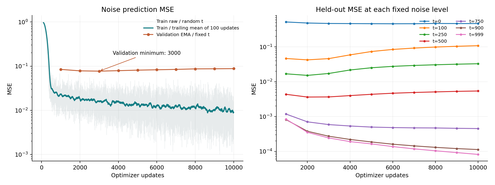
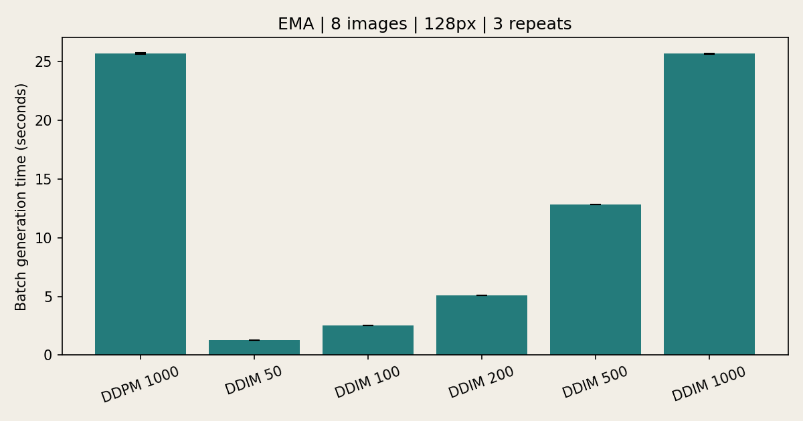
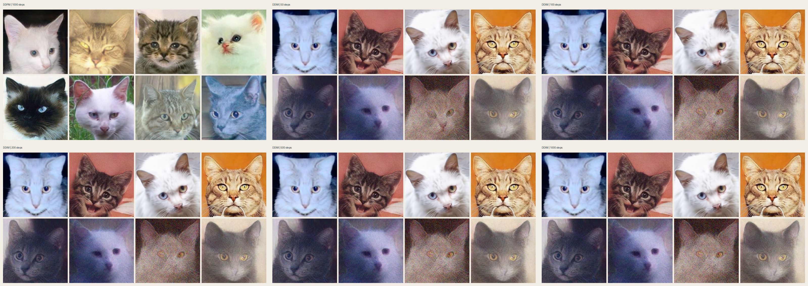
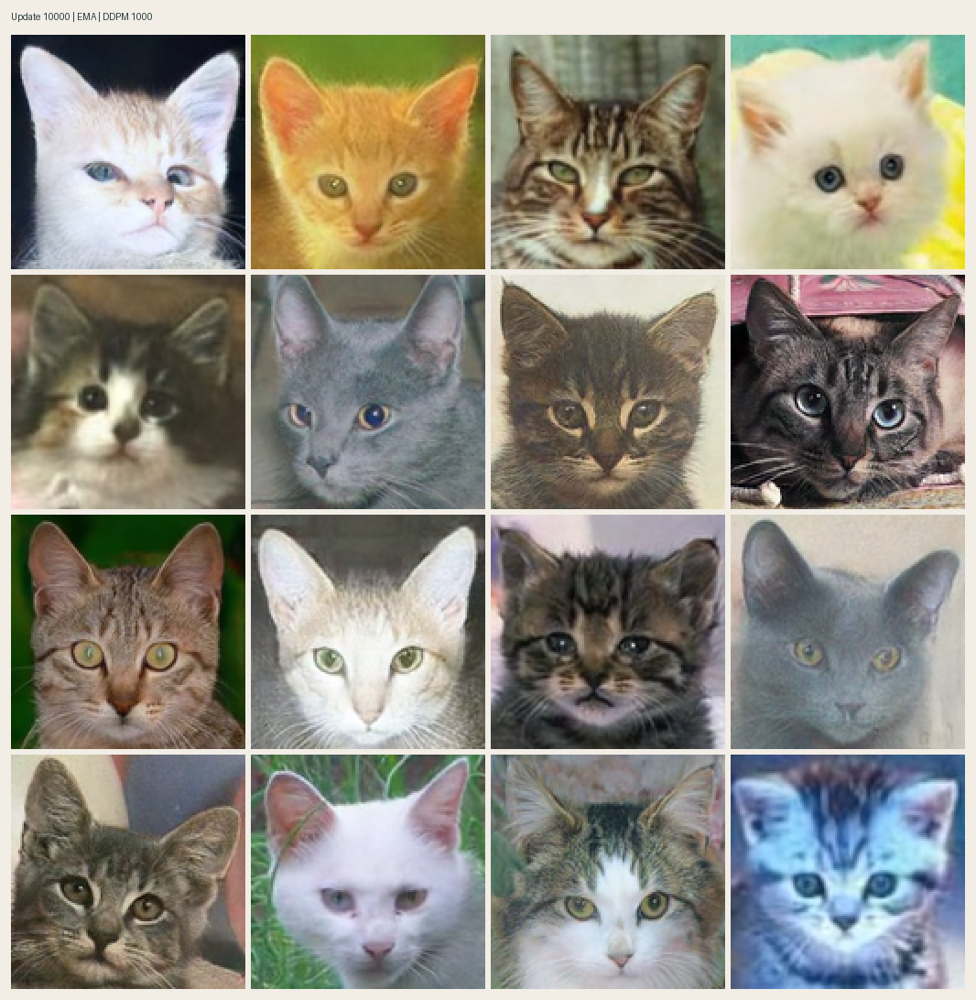
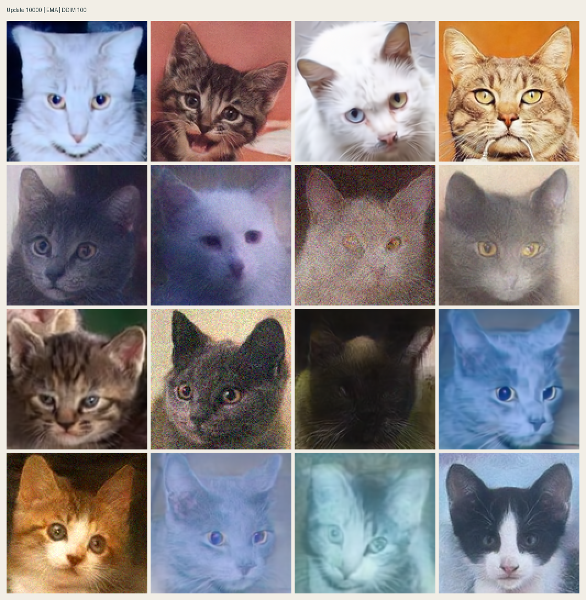
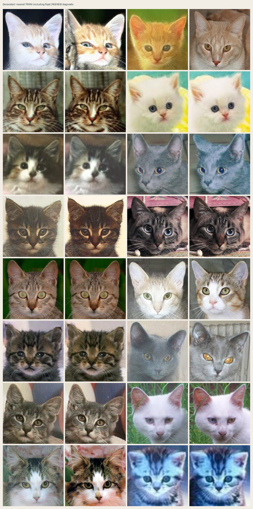
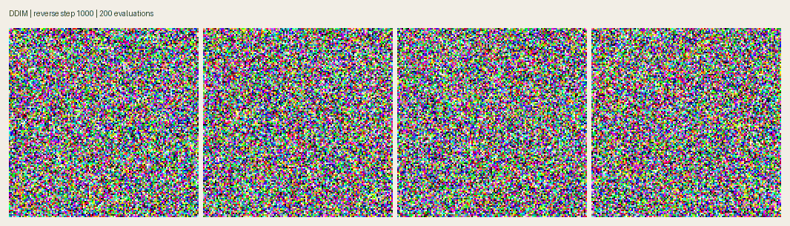

# Генерация котов с помощью DDPM и DDIM

Обучение диффузионной модели с предсказанием шума и сравнение двух алгоритмов генерации на одном EMA checkpoint. Модель обучена с нуля: 78 642 819 параметров, RGB 128×128, 10 000 обновлений на четырёх A100 80 GB.

## Датасет

[huggan/few-shot-cat](https://huggingface.co/datasets/huggan/few-shot-cat): 160 фотографий котов. Подготовленные PNG включены в `data/cats/`. Разбиение с seed 2026: **144 train / 16 validation**. Списки split и SHA256 сохраняются при обучении.

Предобработка: RGB, центрированный квадратный crop и resize Lanczos до 128×128, нормализация в `[-1,1]`. Случайное горизонтальное отражение применяется только к train. Validation не участвует в обновлении весов. Меток классов и conditioning нет.

## Архитектура и обучение

| Параметр | Значение |
|:--|:--|
| Архитектура | Residual U-Net, timestep conditioning через scale/shift |
| Параметры | 78 642 819 |
| Изображение | 3×128×128; pixel space, без VAE и латента |
| Каналы | 128, 128, 256, 384, 512 |
| Attention | Разрешения 16×16 и 8×8, SDPA, 8 голов |
| Diffusion | 1000 уровней, linear β от 0.0001 до 0.02 |
| Loss | Невзвешенная MSE между добавленным и предсказанным шумом |
| Оптимизатор | AdamW, LR 1e-4, weight decay 0.01 |
| Scheduler | Warmup 1000 updates, затем cosine decay с бюджетом 50 000 |
| Обучение | Остановка на 10 000 обновлениях; global batch 32 = 8 × 4 GPU |
| Эквивалент эпох | 320 000 предъявлений / 144 ≈ 2222; включает padding потока |
| Стабилизация | Dropout 0.1, clipping norm 1, EMA до 0.999 |
| Precision | Обучение BF16; validation и benchmark FP32 |
| Валидация | Каждые 1000 updates, все 16 изображений × 7 фиксированных уровней |
| Превью | DDIM 100 каждые 1000; DDPM 1000 каждые 5000 и при остановке |

Конфигурация: [configs/train.yaml](../configs/train.yaml). Шаг оптимизатора и timestep diffusion — разные счётчики. Для генерации выбран EMA snapshot шага 10 000; `best.pt` по validation MSE соответствует шагу 3000. Формулы и устройство кода — в [docs/theory.md](../docs/theory.md).

## Установка и запуск

Среда обучения: Python 3.10.12, PyTorch 2.9.1+cu128, CUDA runtime 12.8, Linux x86_64. Зависимости фиксированы в `requirements.txt`. В уже подготовленной среде пода повторная установка не требуется.

```bash
python -m venv .venv
source .venv/bin/activate
pip install -r requirements.txt
```

Проверка GPU и короткий запуск:

```bash
python scripts/preflight.py --config configs/train.yaml
python -m torch.distributed.run --standalone --nproc-per-node=4 train.py --config configs/ddp-smoke-gpu.yaml
```

Обучение с теми же параметрами и остановкой на выбранном шаге:

```bash
python -m torch.distributed.run --standalone --nproc-per-node=4 train.py --config configs/train.yaml --stop-after-updates 10000
```

Для продолжения прерванного запуска добавить `--resume experiments/cats128-gpu/last.pt`. Сохранённые world size, конфигурация и содержимое датасета должны совпадать. Для одной GPU тот же trainer запускается через `python train.py --config configs/train.yaml --stop-after-updates 10000`; global batch при этом будет 8 и это уже другой эксперимент.

## Генерация

[EMA checkpoint шага 10 000](https://github.com/RahimGulyamov/cats-ddpm-ddim/releases/download/submission-v1/cats128-step10000.pt) доступен через GitHub Release; [SHA256 и сведения о весах](../results/checkpoint.json). Сохранить его в `checkpoints/cats128-step10000.pt`:

```bash
mkdir -p checkpoints
curl -fL https://github.com/RahimGulyamov/cats-ddpm-ddim/releases/download/submission-v1/cats128-step10000.pt -o checkpoints/cats128-step10000.pt

python sample.py --checkpoint checkpoints/cats128-step10000.pt --method ddpm --steps 1000 --count 16 --device cuda --output generated/ddpm
python sample.py --checkpoint checkpoints/cats128-step10000.pt --method ddim --steps 100 --count 16 --device cuda --output generated/ddim
```

DDIM позволяет менять `--steps`; полный DDPM здесь использует 1000. Для CPU или Mac заменить `--device cuda` на `--device cpu` / `--device mps` соответственно. Сэмплинг на CPU существенно дороже коротких проверок маленькой модели.

## Логи и результаты обучения

За 10 000 обновлений обучение заняло **1932.1 с (32.2 мин)**, включая validation, previews и сохранение файлов. Пропущенных обновлений: 0.

| Метрика | Значение |
|:--|--:|
| Train MSE, последний batch | 0.002519 |
| Train MSE, среднее последних 1000 обновлений | 0.010214 |
| Лучший fixed-level validation MSE (EMA), шаг 3000 | 0.077072 |
| Validation MSE, шаг 10 000 | 0.087958 |



Тонкая линия — train MSE каждого batch, сглаженная — скользящее среднее последних 100 обновлений. Сглаживание применяется только к графику; исходные CSV сохранены. [Полный dashboard: LR, градиенты, скорость и память](../results/training/training-dashboard.png). Перерисовка loss из CSV: `python scripts/plot_results.py`.

[Train CSV](../results/training/train.csv) содержит каждое обновление: MSE, оптимизируемый loss, LR, gradient norm, число предъявлений, время, throughput, peak allocated/reserved memory. [Validation CSV](../results/training/validation.csv) содержит noise MSE и ошибки восстановления x₀ с clipping и без него по уровням `0,100,250,500,750,900,999`. [Summary](../results/training/summary.json) фиксирует оборудование и итог запуска. Численные итоги дополнительно собраны в [analysis.json](../results/training/analysis.json).

TensorBoard при обучении записывает scalar metrics и previews. Для просмотра сохранённых event files:

```bash
python -m tensorboard.main --logdir results/training/tensorboard --host 127.0.0.1 --port 6006
```

Train использует raw weights и случайные t; validation — EMA и фиксированные t. Их абсолютные средние не являются прямой оценкой разрыва обобщения. Для выбора checkpoint сравнивается динамика одной и той же validation.

## Сравнение DDPM и DDIM

Один EMA checkpoint шага 10,000, batch 8, seed 2026, FP32, DDIM eta=0. Устройство: **NVIDIA A100 80GB PCIe**, PyTorch 2.9.1+cu128. Для каждого метода проведён прогрев и три измерения с синхронизацией устройства. Загрузка весов и запись файлов исключены; сэмплинг на одной GPU.

| Метод | Шаги | Batch 8, с (mean ± std) | Ускорение к DDPM |
|:--|--:|--:|--:|
| DDPM | 1000 | 25.714 ± 0.068 | 1.00× |
| DDIM | 50 | 1.278 ± 0.000 | 20.12× |
| DDIM | 100 | 2.558 ± 0.001 | 10.05× |
| DDIM | 200 | 5.118 ± 0.002 | 5.02× |
| DDIM | 500 | 12.815 ± 0.007 | 2.01× |
| DDIM | 1000 | 25.680 ± 0.011 | 1.00× |





[Исходные замеры JSON](../results/comparison/timings.json), [CSV](../results/comparison/timings.csv), [все сетки](../results/comparison/). Изображения показываются без отбора. Число вызовов сети равно числу шагов в таблице.

```bash
python benchmark.py --checkpoint checkpoints/cats128-step10000.pt --ddim-steps 50 100 200 500 1000 --count 8 --repeats 3 --device cuda --demo --output results/comparison
```

## Анализ качества и выводы

На шаге 10 000 DDPM даёт узнаваемые морды и заметно более чёткие детали, чем ранние previews. DDIM 100 в промежуточных сетках сохраняет зерно и неестественные оттенки. Все [превью обучения](../results/training/previews/) сохранены без отбора.





На небольшом наборе модель запоминает фотографии: в нескольких генерациях повторяются фон, поза и детали train-изображений. В каждой паре ниже слева генерация, справа ближайшая train-фотография по RGB MSE, включая горизонтальные отражения:



[Все пары и расстояния DDPM](../results/memorization/ddpm/neighbors.json), [проверка DDIM](../results/memorization/ddim/neighbors.png). Это визуальная диагностика запоминания, не FID и не формальный порог копирования. FID не вычислялся.

Validation достигает минимума на шаге 3000 и затем растёт примерно на 14.1%; особенно ухудшаются ошибки на t100/t250/t500. Одновременно высокие уровни шума продолжают улучшаться. Поэтому минимальный train loss и резкость отдельных картинок не означают улучшение обобщения. Большое число параметров на 144 train изображениях ограничивает разнообразие результата.

В сравнении batch 8 DDPM даёт меньше выраженного зерна и более ровные оттенки. У DDIM первые четыре изображения узнаваемые и достаточно чёткие, но в нескольких остальных сохраняются размытие, зерно и синий оттенок. При увеличении DDIM с 50 до 1000 шагов эти дефекты остаются, а общая структура изображений почти не меняется. Это наблюдение для одного seed и выбранного checkpoint, не доказательство одинакового качества при любом числе шагов.

Дополнительный эксперимент проведён на DDIM 50/100/200/500/1000. На этой сетке увеличение времени примерно в 20 раз от 50 до 1000 шагов не даёт столь же заметного улучшения картинки. DDIM 100 ускоряет batch примерно в 10 раз относительно DDPM 1000; при одинаковых 1000 шагах время обоих методов практически совпадает. Главный источник ускорения — уменьшение числа вызовов U-Net. Больше шагов не устраняет ограничения обученной модели и запоминание данных.

## Демо

Ускоренный обратный процесс DDIM 200 из гауссова шума: [видео MP4](../results/comparison/demo.mp4), [анимация GIF](../results/comparison/demo.gif). Файлы хранятся в этом репозитории. Запись видео выполняется отдельно от замеров скорости. Для MP4 нужен ffmpeg; при его отсутствии генератор сохраняет GIF.



## Проверки

```bash
python -m unittest discover -s tests -v
python scripts/check_gpu_resume.py
```

Проверяются формулы DDPM/DDIM и крайние переходы, repeatable sampling, backward, усреднение градиентов по rank, поток batch и сохранение dropout при activation checkpointing. Отдельная проверка сравнивает непрерывное обучение с остановкой и resume: raw/EMA weights и loss должны совпадать.

Основной запуск прошёл CUDA preflight, DDP/BF16 smoke и продолжение с checkpoint на четырёх A100. Seed, параметры, split и логи сохранены; побитовая идентичность между разными устройствами не обещается.
